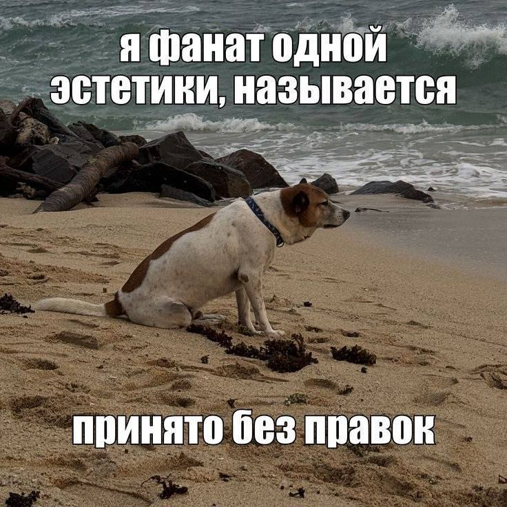

# Лабораторная работа №1

**ФИО**: Афанасенко Александр Иванович

**Группа**: 6403

**Научный руководитель**: Гошин Егор Вячеславович

> Сегодня один говорил со мной насчет того, чтобы ему
 стать жрецом Августа. Я говорю ему: «Человек, оставь это дело, потратишь  много впустую». - «Но пишущие слова, -
 говорит, - напишут мое имя».  - <...> - «Останется мое имя». - «Напиши его на камне, и оно останется. Ну а за пределами Никополя какая о тебе останется память?» - «Но я буду носить золотой венок». - «Раз уж ты жаждешь венка, возьми венок из роз и надень - в нем ты будешь выглядеть наряднее».
>
> *Эпиктет*

---

# Лабораторная работа №2

**Тема**: сайт-галерея снимков NASA, свободных для использования, на весь экран. Тексты сайта — на английском.

Сайт лежит в папке [`lab2`](lab2), открыть — [`lab2/index.html`](lab2/index.html).

## Страницы (вкладки)

| Файл | Вкладка | Что на странице |
| --- | --- | --- |
| `index.html` | Home | Полноэкранный снимок и три карточки-категории |
| `earth.html` | Earth | 3 снимка Земли из космоса |
| `moon.html` | Moon | 4 снимка: программа «Аполлон» и вид с МКС |
| `space.html` | Deep Space | Снимки телескопов Webb, Hubble и марсохода Curiosity |
| `catalog.html` | Catalog | Таблица всех снимков |
